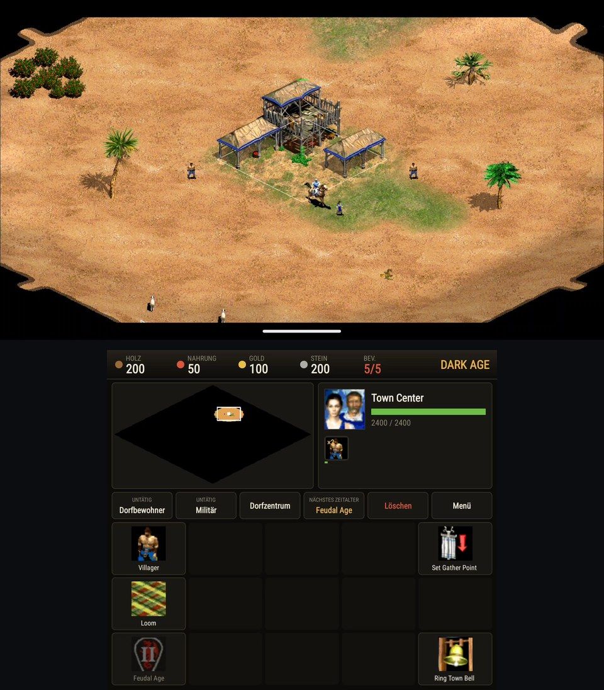
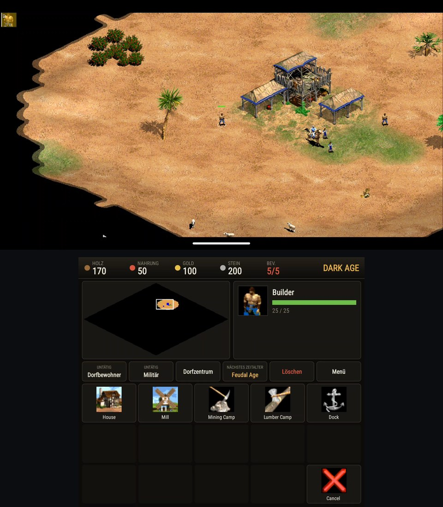

# Thor AoK

**Age of Empires II on the AYN Thor, native, with a command deck on the second screen.**

> Not affiliated with, endorsed by or sponsored by Microsoft. No game data included: you need your own copy of **Age of Empires II HD** (Steam).

▶ **[Watch the install guide](https://youtu.be/cT8PKuzvq-g)** · **[Showcase video](https://youtu.be/a84hUf1OQok)** · **[30-second short](https://youtube.com/shorts/LNoEQ6FEUD0)**

| Town Center selected (top + bottom screen) | Build menu on the deck |
|---|---|
|  |  |

<sub>Real screenshots from an AYN Thor (deck language follows the system language, German here).</sub>

All Thor ports: [toravo.de/en/thor](https://toravo.de/en/thor/) · Made a video about this? Open an issue and I'll link it here.

## Quick start

1. **Install the APK.** Download `ThorAoK-0.1.0.apk` from [Releases](../../releases) on the Thor and install it (allow installing from your browser or file manager once).
2. **Install Age of Empires II HD** from your Steam library on a PC or Mac (or on the Thor through a Steam client such as DroiDeck: the files are what matters).
3. **Convert the data on a PC or Mac** (Python 3, CMake and a C++ compiler; Pillow and NumPy for the terrain):
   ```sh
   git clone <this repository> thor-aok && cd thor-aok
   python3 -m pip install pillow numpy
   python3 android/package.py --hd "<path to>/steamapps/common/Age2HD"
   ```
   This writes `android/build/OpenAoK-data/` (about 300 MB) from your own files.
4. **Copy `OpenAoK-data` to the Thor** (SD card or internal storage, USB or `adb push`).
5. **Start Thor AoK**, tap **Choose data folder**, open `OpenAoK-data`, **Use this folder → Allow**. The app checks every file against the manifest and copies it in; after that it starts straight away (**Play**). The folder on the card can be deleted afterwards.

**Permissions:** none to grant. The import uses Android's folder picker.

If it works for you, a ⭐ on GitHub helps – and [subscribing on YouTube](https://www.youtube.com/@toravomusic?sub_confirmation=1) helps me bring more ports to the Thor.

---

Thor AoK is an Android (arm64) build of [OpenAoK](https://github.com/Zaydme/openaok) by Zaydme, a from-scratch open-source engine for *Age of Empires II: The Age of Kings*, made for the AYN Thor dual-screen handheld:

- **Top screen (1920×1080):** only the map. The top bar and the bottom panel are gone; menus, dialogs and messages are unchanged.
- **Bottom screen (1240×1080):** a touch command deck with wood, food, gold, stone, population and the age; the mini-map (tap or drag to move the view); the selection with its hit points and production queue (tap a queued item to cancel it); quick buttons for the idle villager, idle army, Town Center, the next age, delete and the menu; and the selection's commands as big tiles with the original icons.
- Without a second screen everything stays as in OpenAoK.

## Age of Empires II HD instead of the 1999 CD

Upstream OpenAoK plays from the original 1999 CD. Thor AoK adds a converter (`tools/data/convert_hd.py`, run by `prepare_data.py --hd` and `android/package.py --hd`) that lays out the HD edition's files the way the engine reads them:

| HD (Steam) | What the converter makes |
|---|---|
| `resources/_common/drs/*/` loose SLP / WAV / BINA files | the DRS archives `graphics.drs`, `interfac.drs`, `sounds.drs` |
| `drs/gamedata_x1/*.rms, *.per` | `gamedata.drs` under the 1999 ids; the scripts get the `random_map.def` include HD adds itself |
| `terrain/textures/*.png` | `terrain.drs`: the textures cut into 97×49 isometric tiles in the game's palette |
| `dat/empires2_x1_p1.dat` (The Conquerors' format) | read as is (genieutils `GV_TC`) |
| `en/strings/key-value/key-value-strings-utf8.txt` | `strings.json` instead of LANGUAGE.DLL |
| `sound/stream, civ, music/*.mp3` | the music under the CD's names |

The game plays The Age of Kings' rules from The Conquerors' data: the 13 original civilisations, the original random maps and the computer player from HD's scripts (a few UserPatch commands are understood; rules using Conquerors-only units are skipped).

## Deck

| | |
|---|---|
| **Dual screen** | An Android `Presentation` on display 4 (`FLAG_NOT_FOCUSABLE`). Without a second screen, or with the intent extra `single=true`, the original interface stays on the top screen. |
| **Engine-faithful** | Every deck action goes through the engine's own panel code (`src/thor/Thor.cpp`): a tile runs the command button's click, the mini-map centres the view like a mini-map click, the menu is the top bar's menu button. |
| **Commands** | Tap a tile = press the button (train, research, build menu, stop, bell, …). Long-press = the button's help. Placing a building: pick it on the deck, then tap the spot on the top screen. **Delete** asks first: tap it again within 3 seconds. |
| **Mini-map** | Drawn by the engine's mini-map code (terrain, fog, units) with the view frame. |
| **Languages** | Deck and launcher in English, Deutsch, Español, Français. The game's own text comes from your HD files (English). |

## Sticks and buttons (0.2.0)

| Control | Does |
|---|---|
| Left stick | Moves the pointer |
| Right stick | Scrolls the map; with L2 held, zooms |
| A | Select (hold and move: a box) |
| B | Order: move, gather, build, attack |
| X | Next idle villager |
| Y | Back out of whatever is half done |
| L1 / R1 | Town Center / next idle military unit |
| L2, held | Shift: add to a selection, queue orders, train five |
| D-pad up, right, down, left | Pick control group 1, 2, 3, 4 |
| R2 held + D-pad | Set that control group from the selection |
| Start | Game menu |

Touch on the top screen works as before.

## Building

```sh
cd android && ./fetch_deps.sh && cd ..
thor/build.sh            # → dist/ThorAoK.apk
thor/build.sh --install  # also adb install -r
```

Needs JDK 21, the Android SDK (platform 36, NDK 28.2) and CMake 3.31.6, or another CMake named with `OPENAOK_CMAKE=<version>` and `cmake.dir` in `android/local.properties`. Release signing reads `~/.config/thoraok/env` (keystore path and passwords, never in the repository).

The desktop build works as upstream (`./build.sh`); `THOR_DUAL=1 ./OpenAoK` shows the top screen as the Thor does.

## Known limitations

- The Conquerors' civilisations, units and technologies are in the data but not playable; the computer player skips rules that need them.
- No default hotkeys (they come from the CD's EMPIRES2.EXE, which HD does not have); campaigns and the 1999 bonus scenario are not converted.
- The game's text is English (from HD's English strings).

## Licence

MIT, as OpenAoK. See [LICENSE](LICENSE) and [NOTICE](NOTICE). Upstream's own README: [README.upstream.md](README.upstream.md).
