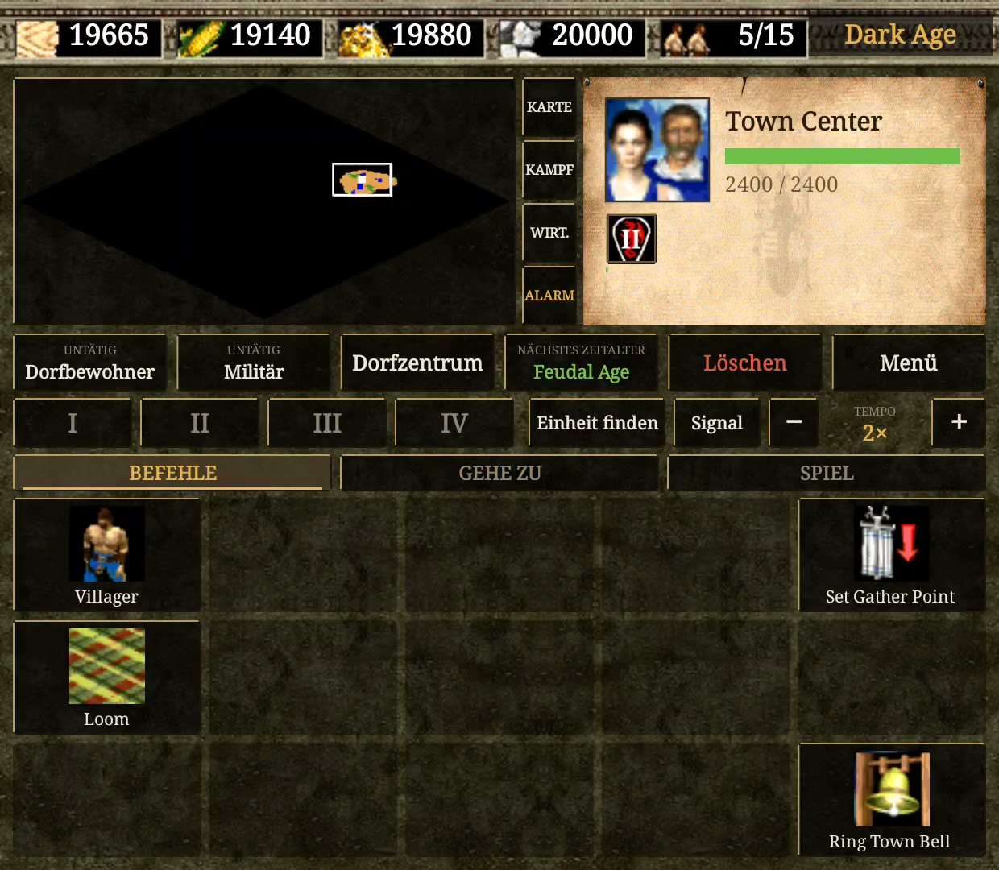

All Thor ports: [toravo.de/en/thor](https://toravo.de/en/thor/)

## Thor AoK 0.3.0: the deck in the game's look, with a lot more on it

### New on the bottom screen
- **Game look:** the deck is drawn with the game's own interface art from your files: the top bar with its stockpile slots, the parchment, the stone of your civilisation.
- **Control groups I to IV:** hold to store the selection, tap to pick it, tap again to look at it (the same groups as the D-pad's).
- **Go to:** a page with your buildings and how many you have; a tap selects the next one.
- **Game page:** objectives, tech tree, statistics, game time, menu.
- **Find the selection, flare, game speed** (1×, 1.5×, 2×) beside the groups.
- **Mini-map modes** (normal, combat, economic) and **last alert** beside the mini-map.

### Tested on the Thor
Death Match: build through the deck, Feudal Age, militia stored as a group by holding, go-to page, speed, tech tree, every stick and button of 0.2.0 (B, right stick, L2 zoom, R1, Y, Start), and a fight against the computer's army.

### Updating
From 0.2.0: install over it, the game data stays. From 0.1.0: the data must be made again with this version (`python3 android/package.py --hd <Age2HD>`).

### Known limitations
- The Age of Kings civilisations and rules only. No keyboard hotkeys, no campaigns. Converting the HD files still needs a PC or Mac.
- The tech tree and other full screens are stretched to the top screen's width.

`ThorAoK-0.3.0.apk` · SHA-256 in `ThorAoK-0.3.0.apk.sha256`
